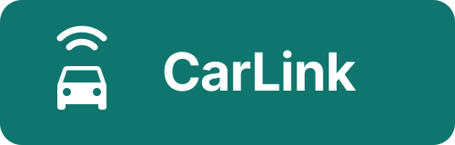

<p align="center">
  
</p>

CarLink brings Android Auto to cars whose screen only supports CarbitLink (also called EasyConnection) or QDLink phone mirroring.

The app runs on your phone. It starts a local Android Auto session and sends it to the car, over a USB cable or wirelessly over Wi-Fi Direct. Touches on the car screen go back to Android Auto.

<p align="center">
  
</p>

## Screenshots

<p align="center">
  
  
  
</p>
<p align="center">
  
</p>
<p align="center"><sub>2026 Geely Emgrand (head unit EC-KY-4350), connected wirelessly.</sub></p>

## Will it work in my car?

- **Tested:** 2026 Geely Emgrand (Egypt, head unit EC-KY-4350), over cable and wireless. One other CarbitLink head unit over cable. A 2026 Geely Emgrand with QDLink over cable.
- **Likely to work:** cars from Geely, Chery, Jetour, BAIC, JAC, GAC and Proton whose screen has CarbitLink, EasyConnection or a "phone link" app. This list comes from adapter listings and owner guides, not from our own tests.
- **Tried it in your car?** Open an [issue](../../issues) with the car model and year, the name of the phone-link app on the car screen, cable or wireless, and whether it worked.

## What you need

- An Android 10 or newer phone with Android Auto
- A car whose screen has CarbitLink, EasyConnection or QDLink
- A USB data cable, or Wi-Fi turned on for wireless

## Download

Download [CarLink.apk](https://github.com/ibrahimdawood/carlink/releases/latest/download/CarLink.apk), the latest release. Android asks once to allow installs from your browser or chat app. The app checks for updates by itself.

## Setup

The app walks you through this the first time:

1. Allow notifications, location and the microphone.
2. Turn on Android Auto developer mode: open Android Auto settings and tap Version 10 times.
3. Start Android Auto's server: tap ⋮, then Start head unit server.
4. Connect to your car:
   - **Cable:** plug the phone into the car's USB port, then choose CarLink and Always.
   - **Wireless:** tap Connect without a cable, then tap your car. Keep the car screen on the phone-link page.

## Every drive

- **Cable:** plug in. Android Auto opens on the car screen by itself.
- **Wireless:** open CarLink. It finds your car and connects. You can close the app after that.

Plugging in the cable while connected wirelessly switches over without restarting Android Auto. Music, navigation voice and calls play through the phone's Bluetooth to the car, so keep the phone paired with the car.

## Phone screen on the car

Besides Android Auto, CarLink can show your phone's own screen on the car, so you can use apps that Android Auto doesn't have.

- **Start it:** on the phone, tap **Show phone screen on the car**. Or on the car screen, tap **Phone screen**. Android asks every time whether to allow screen sharing: tap Start now.
- **Touch from the car:** turn on **CarLink touch control** once in Settings → Accessibility (CarLink offers to open it). Tap, swipe, scroll and long press work with one finger. The car's Back key is the phone's Back. Without touch control the car only shows the screen.
- **Fill the screen:** a phone held upright shows in the middle with black bars at the sides. Turn the phone sideways to fill more of the car screen.
- **Back to Android Auto:** tap **Back to Android Auto** in the app or in the notification, or press the car's Home key and then Open Android Auto.

## If something goes wrong

- **"Android Auto needs a tap":** Android Auto's server stops when the phone restarts. Tap the notification, then ⋮ and Start head unit server.
- **Stuck on "Starting…":** go to Settings → Apps → Android Auto → Force stop, then start the server again.
- **The QDLink app opens instead:** go to Settings → Apps → QDLink → Open by default, clear it, then plug in again and choose CarLink.
- **Can't find your car:** make sure the car screen is on and showing the phone-link page, Wi-Fi is on, and the phone is close by.

## Known limits

- Android Auto's developer mode is not an official feature, so an Android Auto update can break it.
- QDLink cars work over cable only.

## Building

Needs JDK 17 and the Android SDK.

```bash
./gradlew assembleDebug
```

Release builds are signed only when `keystore.properties` (storeFile, storePassword, keyAlias, keyPassword) is in the project root. It is gitignored.

### Releases

Every push to `main` runs `.github/workflows/release.yml`: it builds a release APK as version `1.3.<run number>`, tags it `v1.3.<run number>` and publishes it as a GitHub Release with `CarLink.apk` attached. The in-app update checker picks it up from there.

To sign with your own key, add these repository secrets: `RELEASE_KEYSTORE_BASE64` (the keystore file in base64), `RELEASE_KEYSTORE_PASSWORD`, `RELEASE_KEY_ALIAS`, `RELEASE_KEY_PASSWORD`. Without them the APK is signed with the committed debug key. Switching keys later means uninstalling the app once.

## Credits

Based on [AA Bridge](https://github.com/alimorgaan/AA-Bridge) by Ali Morgan, which is based on [CarAALink](https://github.com/JObersi10/CarAALink) by JObersi10. The Android Auto head unit certificate comes from aasdk, see [PROVENANCE.md](app/src/main/assets/aa/PROVENANCE.md).

## License

GPL-3.0, see [LICENSE](LICENSE).

Android Auto is a trademark of Google LLC. CarLink is not affiliated with Google or the makers of CarbitLink or QDLink.
